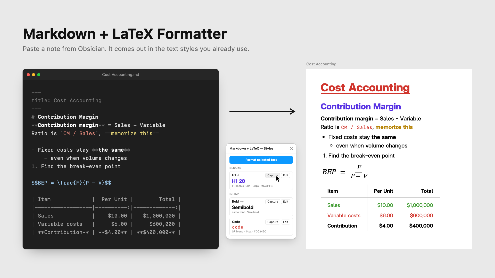

# Markdown + LaTeX Formatter



A Figma plugin that turns Obsidian-style markdown pasted into a text layer into styled text, tables and rendered LaTeX equations. It uses **your own styles**, captured from layers already on your sheet.

## Commands

| Command | What it does |
|---|---|
| **Format selection** | Formats the selected text layer(s) with the styles saved in this file, then closes. |
| **Styles & settings…** | Opens the panel where you capture, edit, apply, export and import styles. It also has a *Format selected text* button. |

## Style slots

Every markdown element maps to a slot:

| Slot | Markdown |
|---|---|
| Title | `title:` in the YAML frontmatter |
| H1 – H4 | `#` … `####` (`#####`+ use H4) |
| Body | normal text and list items |
| Bold / Italic / Bold italic | `**text**`, `*text*` / `_text_`, `***text***` |
| Code | `` `text` `` |
| Highlight | `==text==` |
| Table header / cell | markdown tables |

### Capturing a style from your sheet
1. Open **Styles & settings…**.
2. On the canvas, select a layer that already looks right, for example your "H1 28". You can also highlight part of a text layer.
3. Click **Capture** on the matching slot. This copies the font, size, color, line height, letter spacing, decoration and case. If the layer uses a Figma text style, the result stays linked to it.

For **Bold / Italic**, *Capture* only takes the weight (for example `Semibold`), so `**text**` inside an H2 keeps the H2 font, size and color. You can also click **Edit** and type a style; leave *Family* empty to mean "the surrounding font". If a font doesn't have the exact style, the closest weight is used and the plugin tells you. It never silently switches to Inter.

**Apply** puts a slot's style on the selected layer or text. Use it, for example, for a title line that isn't in frontmatter.

### Sharing styles between files
Styles are saved **inside each Figma file**. Use **Export JSON** (copy or download) and **Import** in another file to reuse them.

## Supported markdown
- Headings, frontmatter title
- `**bold**`, `*italic*`, `***both***`, `` `code` ``, `==highlight==`, `~~strike~~` (markers removed), `\*` escapes
- Bullet, numbered and nested lists (tabs or spaces), tasks `- [ ]` → ☐ / ☑
- Tables → auto-layout frame (header divider, column dividers, `:--:` / `--:` alignment). `$math$` inside a cell is rendered in that cell, sized and colored to match its text.
- `[[wikilink|alias]]` → alias, `[label](url)` → hyperlink, `![[embeds]]` and `%%comments%%` removed
- Callouts `> [!note] Title` → bold title, quote markers removed
- `$inline$` and `$$display$$` LaTeX in normal text → SVG equations placed below the text (Figma can't put an image inside a text layer). `$10 and $20` stays as text.

Highlight note: Figma can't paint a background behind part of a text layer, so `==text==` uses the Highlight slot's text styling (color, underline, weight…).

**Frames:** if the text layer only sits *on top of* a frame (for example, text pasted onto an A4 page), Format selection first moves it into that frame without moving it on screen. The text, tables and LaTeX then all belong to the frame and export with it. Auto-layout frames are never used as the target, so nothing gets reflowed.

When a note contains a table, the text layer is replaced by a vertical auto-layout frame ("Markdown") that holds the text, the table(s), then more text.

Try `samples/obsidian-sample.md`.

## Development

```bash
npm install
npm run build   # or: npm run watch
npm run lint
```

Import in Figma Desktop: **Plugins → Development → Import plugin from manifest…** and pick `manifest.json`.

Remember to run `npm run build` after editing `code.ts`. Figma runs `code.js`.
